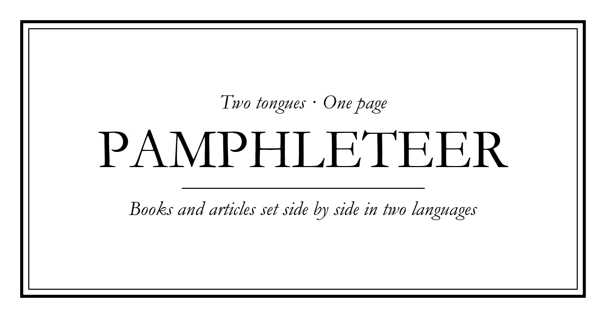

# Pamphleteer

*Many tongues · One page.*

Pamphleteer lays a book or article beside its translations. Upload the same work in two, three or four languages and it sets them in parallel columns, chapter by chapter and paragraph by paragraph, as one long page to scroll.



## How it works

- **Nothing is uploaded.** Files are read in the browser. It's a static site with no server and no build step.
- **Formats:** PDF, EPUB, DOCX, HTML, FB2, Markdown, SRT and plain text. Each side can use a different format, and you can paste text instead.
- **Cheap on big books.** Parsers load only when a format needs them (pdf.js, JSZip, mammoth). Alignment is two cheap passes:
  1. Each text is aligned to the first one. Chapters are matched by their numbers (*Chapter IV* ↔ *Chapitre IV*). Tables of contents are skipped.
  2. Inside each chapter, paragraphs are paired by a banded Gale–Church style alignment on paragraph length, allowing 1–1, 1–2, 2–1, 2–2 and 1–3 groupings. Very long texts without chapters fall back to a single linear pass.
  Long works are split into pages, one per chapter, and long chapters are cut at about 30,000 characters per language. Use the page picker, the ‹ › buttons or the arrow keys; the browser's Back button works too. Each page also adds rows as you scroll.
- **Short texts can be translated** (up to 60,000 characters) when you only have one language:
  - *This browser:* Chrome's on-device Translator API. Free, and nothing leaves the machine.
  - *Claude:* uses your own Anthropic API key, called straight from the page. The key is never stored.
  - *MyMemory:* free public API with no key, limited to about 5,000 characters a day.
- **Hover a word** to see a short gloss: its translation into another column's language and the first dictionary sense.
- **Click a word** to open the dictionary panel. It shows translations into every other language on the page and the full Wiktionary entry. Linked words such as "inflection of *être*" open in place.
  - Definitions come from the English Wiktionary REST API, which is free, needs no key and covers about 4,000 languages.
  - Translations use the browser's on-device translator, falling back to MyMemory.
  - Words are found from the pointer position on demand, so the page never wraps each word of a book in its own element.
- **Typefaces:** EB Garamond, Cormorant, Libre Baskerville, Crimson Pro, Old Standard, Noto Serif (with Chinese and Japanese) or the system serif. Your choice is remembered.
- **Columns** can be hidden, shown or rotated from the toolbar.
- **HTML** downloads the parallel text as one self-contained web page.
- **PDF** lays out the entire book, every page, and opens the print dialog; choose *Save as PDF*. Pages are A4, portrait for 2 columns and landscape for 3–4, with each chapter on a new page. The text stays selectable and searchable.

## Try it

On the start page, click **English & French** or **English, French & German**. These load public-domain *Alice's Adventures in Wonderland* texts from Project Gutenberg ([#11](https://www.gutenberg.org/ebooks/11), [#55456](https://www.gutenberg.org/ebooks/55456), [#19778](https://www.gutenberg.org/ebooks/19778)) out of `samples/`.

## Run locally

```bash
python -m http.server 8000
```

Then open http://localhost:8000. Any static file server works.

## Layout

```
index.html        page shell
css/style.css     black & white, EB Garamond
js/extract.js     file → paragraphs (per format)
js/align.js       chapter matching + paragraph alignment
js/translate.js   short-text and single-word translation
js/dict.js        hover gloss + Wiktionary dictionary panel
js/app.js         upload UI and the scrolling reader
assets/           favicons and social images
samples/          public-domain test texts
```

## License

MIT. The sample texts are in the public domain (Project Gutenberg).
